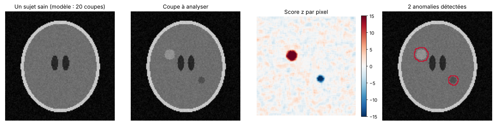

# MedScan Analyzer : détection d'anomalies par analyse des pixels

🇫🇷 [Français](#français) · 🇬🇧 [English](#english)

**Essayer la démo / Try the demo :** https://valentin-auger-laboratoire.github.io/portfolio/demos/medscan/



> Images **de synthèse** (ellipses et bruit), aucune donnée de patient. Projet d'étude, **pas un logiciel de diagnostic**.

---

## Français

### Le principe
Pour repérer une zone anormale sur une coupe, on la compare à ce qu'on attend chez des sujets sains :
1. un **modèle sain** est construit à partir de 20 coupes sans anomalie : pour chaque pixel, on calcule la moyenne et l'écart-type de l'intensité, après un léger lissage ;
2. pour l'image à analyser, chaque pixel reçoit un **score z** : de combien d'écarts-types il s'éloigne du modèle ;
3. les pixels au-delà du seuil (|z| > 5 par défaut), à l'intérieur du corps (seuil d'**Otsu**), sont nettoyés par une **ouverture morphologique**, puis regroupés en **régions connexes** ;
4. chaque région est décrite : surface en pixels et en mm², centre, contraste, type (hyperintense ou hypointense), score z maximal. Les régions trop petites sont rejetées.

Tout est écrit avec `numpy`, sans bibliothèque de traitement d'image : seuil d'Otsu, moyenne locale par images intégrales, érosion et dilatation, étiquetage des composantes par union-find.

### Utilisation
```bash
python analyse.py --seuil 5
```
```
2 anomalie(s) détectée(s) (seuil z = 5) :
  1. hyperintense centre (50, 45) · 179 px = 403 mm² · contraste +22 · z max 34.4
  2. hypointense  centre (80, 82) · 78 px = 176 mm² · contraste -19 · z max 31.3
Recouvrement avec la vérité (Dice) : 0.77
```
L'image annotée est écrite dans `images/resultat.png`.

### Fichiers
| Fichier | Contenu |
|---|---|
| `demo/` | démo web (copie de celle du portfolio), avec ses tests : `node demo/tests/test.js` |
| `medscan/analyse.py` | Otsu, moyenne locale, morphologie, composantes connexes, modèle sain, détection, Dice |
| `medscan/fantome.py` | coupes de synthèse avec ou sans lésions |
| `analyse.py` | démonstration et image annotée |
| `figures.py` | figure ci-dessus (matplotlib) |
| `tests/test_analyse.py` | 34 vérifications : `python tests/test_analyse.py` |

Les tests vérifient chaque brique contre un calcul direct (Otsu contre une recherche exhaustive, moyenne locale contre une boucle), l'absence de fausse alerte sur 8 sujets sains jamais vus, la détection, la localisation et le type de 4 lésions différentes, et la limite de détection : une lésion de 1,5 pixel peu contrastée n'est pas vue.

### Limites
- Images de synthèse parfaitement alignées. Sur de vraies images, il faudrait d'abord les **recaler** sur le modèle et corriger les variations d'intensité.
- Le lissage élargit un peu les contours (de l'ordre de 2 pixels), d'où un Dice autour de 0,7–0,8.
- Un seuil fixe sur le score z : pas d'apprentissage, pas de prise en compte de la forme des lésions.

Dépendances : `numpy`, `Pillow` (et `matplotlib` pour la figure). Projet écrit en 2026.

---

## English

**Pixel-based anomaly detection on medical images.** A healthy model (per-pixel mean and standard deviation over 20 smoothed healthy slices) is compared with the image under study: pixels whose z-score exceeds the threshold inside the body (Otsu mask) are cleaned by morphological opening and grouped into connected regions, each described by area, centre, contrast, type and peak z. All image processing is written with `numpy` only.

```bash
python analyse.py --seuil 5
python tests/test_analyse.py   # 34 checks
```

**Synthetic** images, no patient data. Study project, not diagnostic software. Requires `numpy`, `Pillow` (`matplotlib` for the figure). Written in 2026.
